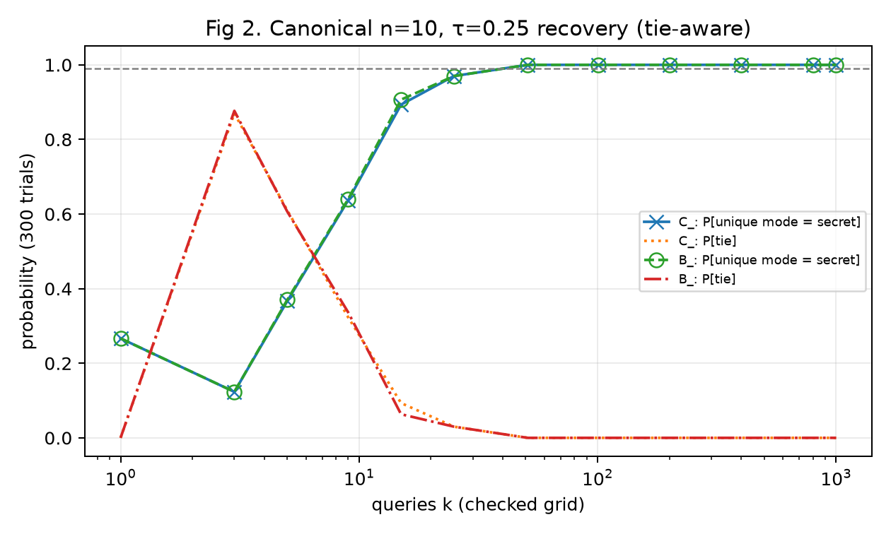
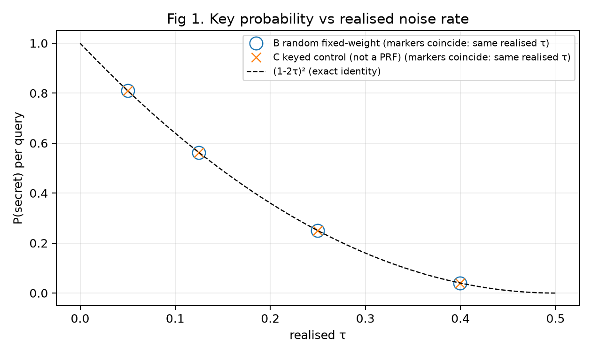
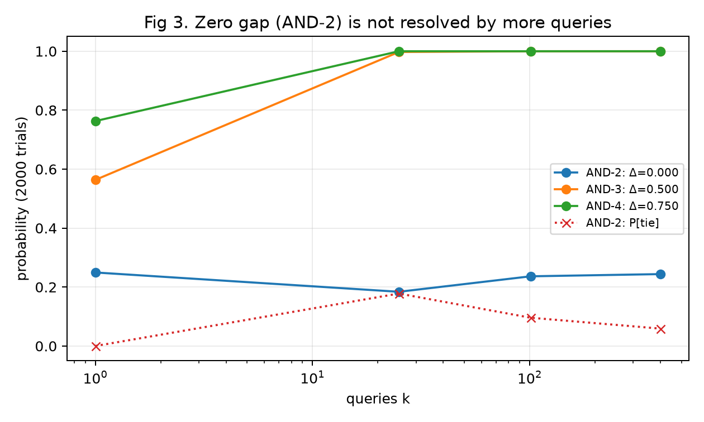
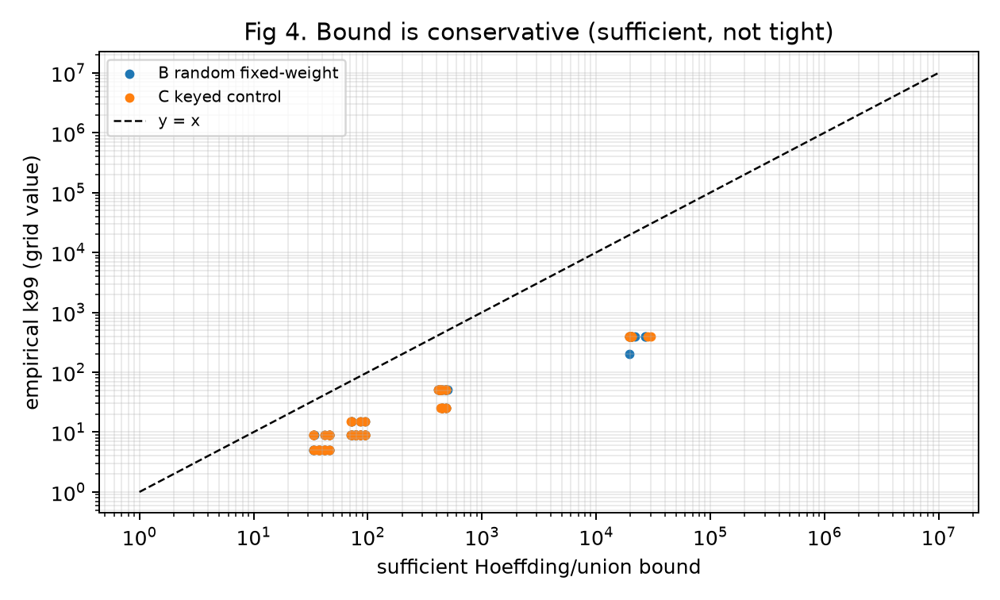

# Spectral Leakage and Repeated Bernstein–Vazirani Key Recovery under Deterministic, Input-Dependent Noise

**[Researcher name]**, B.E. Robotics and Artificial Intelligence, Thapar Institute of Engineering and Technology
Technical report, not peer reviewed · Status: **control framework verified; published-construction experiment pending** · 8 October 2026

## 2. Abstract
Cid, Elkouss and Goulão (2026) showed that HB-family authentication protocols are broken under quantum superposition (Q2) access. The Bernoulli error is sampled once per query, becomes a global phase, and a single Bernstein–Vazirani (BV) query reveals the secret. They noted that this does not apply when the error is a deterministic function of the input. We study that case under an idealised Q2 phase oracle. The BV output distribution is exactly the secret-shifted squared Walsh spectrum of the noise sign function. For an exact fixed-weight noise table this gives P(secret) = (1−2τ)², and recovery by repeated queries depends on the spectral gap Δ = P(secret) − max_{u≠0} ĥ(u)².

In finite control experiments (n = 8–14, 80 distinct truth tables per family), random fixed-weight noise kept Δ > 0 in all 80 cases. A keyed, non-cryptographic control family gave Δ ≤ 0 in 4 of 5 tables at n = 8, τ = 0.4. A two-bit AND noise function produces an exact spectral tie that repeated queries cannot resolve. A tie-handling correction to the empirical estimator changed the canonical n = 10, τ = 0.25 query requirement from 25 to 51. **No published deterministic-LPN construction has been evaluated yet**, so no statement is made about the security of any real scheme.

## 3. Motivation
LPN-based authentication (HB, HB+, HB#) uses only inner products and noise, which makes it attractive for low-resource devices. Cid, Elkouss and Goulão argue that such protocols may run on quantum devices in future networks, where an attacker can query them in superposition. Deterministic-noise variants of LPN are a natural candidate countermeasure, because the noise then depends on the input. Whether this actually suppresses the leakage is a quantitative question about the noise function. This report turns "does the noise hide the key?" into a measurable spectral criterion.

## 4. Connection to the source paper
- **CEG 2026, §7.1:** with error `e` sampled once per query, the phase oracle gives `(−1)^e·(−1)^{a·x}`, a global phase, so BV returns x exactly. Our group A reproduces this (P(x) = 1 in all cases).
- **CEG 2026, §8:** "our attacks do not work against the versions of the HB protocols based on deterministic LPN … the noise will depend on the input to the oracle, and therefore does not become a global phase." The authors add that they "would be surprised" if other superposition attacks were as simple and efficient. This is the gap studied here.
- **CEG ePrint 2026/2258, §8.2** (Dilithium): their model does "not use the message in superposition", but deterministic error "gives a strong indication that the deterministic version is more robust against superposition attacks". This is a heuristic about a different scheme. Our results neither confirm nor refute it.

## 5. Threat model: the Q2 phase oracle
The prover is modelled as the unitary `|a⟩ ↦ (−1)^{a·x ⊕ e(a)}|a⟩`, with secret `x ∈ {0,1}^n` and deterministic noise bit `e(a)`. The attacker prepares the uniform superposition, makes one query, applies `H^{⊗n}`, measures, and repeats with fresh queries. **Not modelled:** gate or device noise (except the output-depolarising check in §14), protocol transcripts, verifier behaviour, the HB+ blinding vector beyond its global-phase role, or compilation.

## 6. Mathematical derivation
With `h(a) = (−1)^{e(a)}` and `ĥ(u) = 2^{−n} Σ_a h(a)(−1)^{a·u}`, the amplitude of outcome `j` is
`α_j = 2^{−n} Σ_a h(a)(−1)^{a·(x⊕j)} = ĥ(x⊕j)`, so **`P(j) = ĥ(x⊕j)²`**. By Parseval the distribution is normalised.
At `j = x`: `ĥ(0) = 1 − 2τ_realised`, so **`P(x) = (1 − 2τ_realised)²`** for any noise table with exactly `τ_realised·2^n` ones. The full derivation, including the concentration bound, is in `docs/METHOD_AND_DERIVATIONS.md`.

## 7. Walsh-spectrum interpretation
Input-dependent noise is a *relative* phase. The final Hadamard layer maps the sign pattern `h` to its Walsh spectrum, translated by `x`. The secret keeps exactly the "DC" weight `(1−2τ)²`. The rest of the probability, `1 − (1−2τ)²`, is distributed over other outputs `x⊕u` according to how strongly `e` correlates with each linear function `a·u`. Noise that is close to linear concentrates probability on a wrong output; noise with a flat spectrum spreads it thinly.

## 8. Spectral-gap criterion
`Δ = P(x) − max_{u≠0} ĥ(u)²`:
- `Δ > 0`: the secret is the unique modal output of the ideal distribution;
- `Δ = 0`: structural tie (classified as a tie when `|Δ| < 10⁻¹²`);
- `Δ < 0`: another output is more likely.

**Sufficient bound.** Comparing the secret with each competitor by Hoeffding (range 2) and a union bound gives `k ≥ (2/Δ²) ln((2^n−1)/δ)`. The implementation uses the slightly larger `(2/Δ²) ln(2(2^n−1)/δ)`, which is still sufficient. This is a guarantee, not an estimate of the required queries (Fig. 4).

## 9. Experimental design
- **Estimator:** the unique empirical mode of k i.i.d. outcomes. Ties are reported and counted as failures (audit A1). This is categorical mode estimation, not majority voting.
- **Reported Monte Carlo metrics:** P[unique mode = secret] and P[tie] at each k in `K_GRID = (1, 3, 5, 9, 15, 25, 51, 101, 201, 401, 801, 1001)`. `k99` = the smallest checked k with P[unique mode = secret] ≥ 0.99, else "not reached within checked grid".
- **Suite:** n ∈ {8, 10, 12, 14}; target τ ∈ {0.05, 0.125, 0.25, 0.4}; 5 tables per point.
  - Secret rule: x = (7n+3) mod 2ⁿ. Seed rule: 1000 + rep + 31n. Keyed control: key 12345 + rep.
  - Monte Carlo trials: 160 / 200 / 240 / 280 for n = 8 / 10 / 12 / 14. Grid capped at k ≤ 501.
- **Every value is labelled** as exact (spectrum), Monte Carlo (recovery), or bound.

## 10. Controls
| Group | Family | Role |
|---|---|---|
| A | Bernoulli bit sampled once per query | Reproduces the source attack (P(x) = 1) |
| B | Random fixed-weight deterministic table | Generic input-dependent noise |
| C | Keyed deterministic fixed-weight table (splitmix-style mixing) | Reproducible keyed control. **Not a cryptographic PRF.** |
| D | AND-k and linear functions | Deliberately structured low-complexity noise |
| E | Published deterministic-LPN construction | **Pending** (§11) |
| F | Output-depolarising mixture | Robustness check |

## 11. Concrete deterministic-LPN construction (pending)
Cid, Davidson and Phanse (ACNS 2026) give practice-oriented deterministic-LPN instantiations (τ-unbalanced weak PRFs built from diffusion and folding functions). Their full text was not accessible during this work. No construction has been implemented or evaluated, and the keyed control (group C) must not be read as one. The analysis pipeline (`analyse_construction.py`; the app's "Concrete construction" tab) is ready. It requires a dated prediction file before it will run.

## 12. Repeated-query recovery
**Canonical example:** n = 10, x = 0000101101, target and realised τ = 0.25, seed 43, 300 trials per k.

| Family | P(x) (exact) | best competitor (exact) | Δ (exact) | k99 (MC) | sufficient bound |
|---|---|---|---|---|---|
| C keyed control (not a PRF) | 0.25 | 0.01196289 | 0.23803711 | **51** (0.970 at k=25) | 432 |
| B random fixed-weight | 0.25 | 0.01112366 | 0.23887634 | **51** (0.970 at k=25) | 429 |

The pre-audit value k99 = 25 came from the biased tie-breaking and is withdrawn.

Fig. 2 also shows an estimator artefact: P[unique mode = secret] is 0.27 at k = 1 but 0.12 at k = 3, because three samples are usually all different (tie rate 0.87).

**Group B suite** (exact columns are means over 5 tables; k99 lists the distinct values observed; NR = not reached ≤ 401):

| n | τ target | τ realised | P(x) | best competitor | Δ | k99 values |
|---|---|---|---|---|---|---|
| 8 | 0.05 | 0.050781 | 0.807190 | 0.005432 | 0.801758 | 5, 9 |
| 8 | 0.125 | 0.125000 | 0.562500 | 0.015723 | 0.546777 | 9, 15 |
| 8 | 0.25 | 0.250000 | 0.250000 | 0.029932 | 0.220068 | 51 |
| 8 | 0.4 | 0.398438 | 0.041260 | 0.029639 | 0.011621 | NR |
| 10 | 0.05 | 0.049805 | 0.810703 | 0.002250 | 0.808453 | 5 |
| 10 | 0.125 | 0.125000 | 0.562500 | 0.004742 | 0.557758 | 9 |
| 10 | 0.25 | 0.250000 | 0.250000 | 0.009210 | 0.240790 | 51 |
| 10 | 0.4 | 0.400391 | 0.039688 | 0.010532 | 0.029156 | 401, NR |
| 12 | 0.05 | 0.050049 | 0.809824 | 0.000706 | 0.809118 | 5, 9 |
| 12 | 0.125 | 0.125000 | 0.562500 | 0.001467 | 0.561033 | 9, 15 |
| 12 | 0.25 | 0.250000 | 0.250000 | 0.002691 | 0.247309 | 25, 51 |
| 12 | 0.4 | 0.399902 | 0.040078 | 0.003621 | 0.036457 | 401 |
| 14 | 0.05 | 0.049988 | 0.810044 | 0.000187 | 0.809857 | 5, 9 |
| 14 | 0.125 | 0.125000 | 0.562500 | 0.000455 | 0.562045 | 9, 15 |
| 14 | 0.25 | 0.250000 | 0.250000 | 0.000721 | 0.249279 | 25, 51 |
| 14 | 0.4 | 0.400024 | 0.039980 | 0.000931 | 0.039049 | 201, 401 |

Across all 80 B tables: mean P(x) = 0.415548, minimum Δ = 0.006104, Δ > 0 in 80/80, and the largest deviation from `(1−2τ_realised)²` was 2.0 × 10⁻¹⁵.

## 13. Failure and ambiguity analysis
- **AND-2** (`e(a) = a₀ ∧ a₁`, τ = 1/4, n = 10, x = 0000000011): four outputs each have probability exactly 0.25, so Δ = 0. With the tie-aware estimator, P[unique mode = secret] was 0.250, 0.184, 0.237 and 0.244 at k = 1, 25, 101 and 401 (2000 trials each). **More queries do not resolve a structural tie.** The pre-audit estimator reported biased per-output frequencies here; those are withdrawn.
- **AND-1 and linear noise:** Δ = −1. P(x) = 0, and the attack returns `x⊕u` with certainty.
- **AND-3 and AND-4:** Δ = 0.5 and 0.75. Recovery is ≥ 0.997 by k = 25.
- **High τ, small n:** for the keyed control at n = 8, τ = 0.4, **4 of 5 tables had Δ ≤ 0**: 2 negative (Δ = −0.006592) and 2 exact ties. Here P(x) = 0.041 is comparable in size to typical competitor weights at n = 8. Random fixed-weight tables at the same point all had Δ > 0, with mean 0.0116. With 5 tables per family, this difference is **not** evidence of a systematic family effect. At n = 8 and 10, τ = 0.4, k99 was often not reached within 401 queries even when Δ > 0, because Δ is small.

## 14. Robustness extension
Mixing the ideal distribution with the uniform distribution (output-depolarising probability ε) in the canonical keyed example gives:

| ε | 0 | 0.05 | 0.1 | 0.25 | 0.5 |
|---|---|---|---|---|---|
| Δ | 0.2380 | 0.2261 | 0.2142 | 0.1785 | 0.1190 |

The gap stays positive. This is a readout-level check, not a physical device-noise model.

## 15. Results and quantitative discussion
1. The exact identities hold to floating-point precision in all 160 suite tables.
2. Generic input-dependent noise lowers P(secret) to (1−2τ)² but, in these tests, usually leaves the secret uniquely modal. Repeated queries then recover it: about 5–15 queries at τ ≤ 0.125, and about 25–51 at τ = 0.25.
3. Whether recovery succeeds is governed by the spectrum, not by τ alone. Equal τ = 0.25 gives Δ ≈ 0.24 for random tables but Δ = 0 for AND-2.
4. Empirical k99 is 1–2 orders of magnitude below the sufficient bound (Fig. 4).

## 16. Relation to prior work
- **CEG 2026:** source attack and the open question.
- **CEG ePrint 2026/2258:** relative-phase oracle techniques, and the Dilithium deterministic-error heuristic (§8.2).
- **Cid–Davidson–Phanse 2026:** the constructions to be tested.
- **Quantum Goldreich–Levin** (Adcock & Cleve 2002) and quantum algorithms for Goldreich–Levin learning (Li & Yang, arXiv:2001.00014): recovering a heavily weighted linear function from a noisy oracle by Fourier sampling. **The mechanism used here is an instance of this known phenomenon.** The question addressed here is its consequence for deterministic-noise LPN authentication.

## 17. Limitations
- Ideal noiseless oracle.
- Exact enumeration only (n ≤ 14), so no asymptotic claim.
- Controls, not real constructions.
- The keyed control is not a PRF.
- Only 5 tables per point.
- The fixed secret rule is not random sampling over secrets.
- Recovery of x only; HB+'s second key and the HB# matrix structure are not simulated.
- The novelty search is incomplete.

## 18. Novelty boundary and exact contribution
**Contribution supported now:**
- an exact spectral characterisation of BV recovery against input-dependent noise under the ideal Q2 model;
- a spectral-gap criterion with a checked sufficient bound;
- finite control measurements, including structural-tie and negative-gap cases;
- an audited, tie-correct estimator;
- a ready pipeline for evaluating published constructions.

**Not claimed:** novelty or priority; any statement about the security of a published deterministic-LPN scheme; any refutation of the §8.2 heuristic in ePrint 2026/2258.

## 19. Reproducibility
`python tests/test_core.py && python reproduce.py` (about 35 s). Raw CSVs, figures, environment record and a SHA-256 manifest are written to `outputs/` (see `docs/REPRODUCIBILITY.md`).

## 20. Conclusion
Under ideal Q2 access, making HB noise depend on the input changes the attack from exact one-query recovery to a statistical problem governed by the Walsh spectrum of the noise. In our controls, generic input-dependent noise usually leaves the secret uniquely recoverable with tens of queries. Structured or near-linear noise can create exact ties or favour wrong outputs. Whether published deterministic-LPN constructions behave like the random controls or like the structured ones is the open experiment.

## 21. References
1. C. Cid, D. Elkouss, M. Goulão. Superposition Attacks Against LPN-Based Authentication Protocols. *IACR Communications in Cryptology* 3(1), 2026. doi:10.62056/abhey7n4e
2. C. Cid, D. Elkouss, M. Goulão. Superposition Key-Recovery Attacks on Dilithium and Fiat-Shamir Signature Schemes. Cryptology ePrint Archive, Paper 2026/2258.
3. C. Cid, A. Davidson, A. Phanse. Practice-Oriented Instances of Deterministic LPN. ACNS 2026, LNCS 16571, pp. 382–412. doi:10.1007/978-3-032-32560-0_14
4. E. Bernstein, U. Vazirani. Quantum Complexity Theory. *SIAM J. Comput.* 26(5), 1997.
5. N. Hopper, M. Blum. Secure Human Identification Protocols. ASIACRYPT 2001.
6. A. Juels, S. Weis. Authenticating Pervasive Devices with Human Protocols. CRYPTO 2005.
7. M. Adcock, R. Cleve. A Quantum Goldreich–Levin Theorem with Cryptographic Applications. STACS 2002.
8. H. Li, L. Yang. Quantum algorithms for the Goldreich–Levin learning problem. arXiv:2001.00014.
